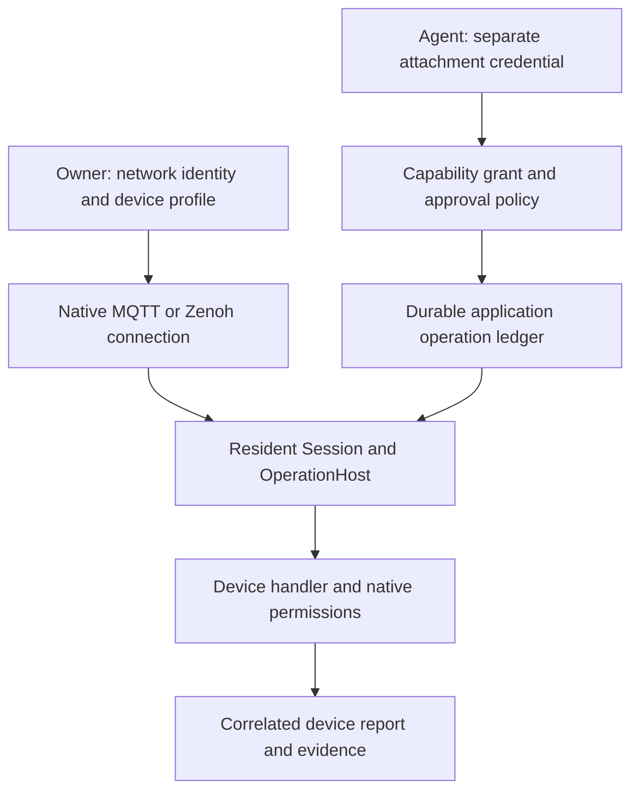

# Embarking an agent into a network

Entryplug's resident service joins the device network once. An agent borrows a
scoped view of its Session, using the same `observe`, `act`, `inspect`, `wait`, and
`cancel` interface as other bodies. MQTT and Zenoh remain native providers. MCP
and A2A are agent interfaces; neither is a required hop to a device.



## Connect, then grant access

1. Install the optional `[ui,mqtt]` or `[ui,zenoh]` dependencies using the project's
   pinned environment. Restart the resident service after installing extras.
2. In **Add body**, choose **MQTT** or **Zenoh**, keeping **Native network** selected.
   Supply `mqtt(s)://host:port` or `tcp/host:port` / `tls/host:port` respectively.
3. Paste the device's `profile` object into **Device profile (JSON)**. Examples:
   [MQTT](../examples/network-mqtt.json) and [Zenoh](../examples/network-zenoh.json).
   These files are complete `/v1/connections` request bodies; the console needs
   just their `profile` field. They describe simulated fixtures, not arbitrary lamps.
4. Connect. Successful transport/subscription setup exposes the configured
   capabilities. It does not prove a current sensor sample or a physical ability.
5. In **Connections → External agents**, choose the body and allowed capabilities.
   Leave per-action approval enabled, or explicitly delegate the selected device
   actions. Copy the attachment's separate credential into the agent's secret store.
   Use its HTTP, MCP, or A2A endpoint as documented in the [operating guide](mission-service.md).

An agent asks for `room.temperature({})` or `lamp.set({"level": 0.5})`. It does not
choose a broker, topic, key, raw payload, or broader network scope with each call.
Normal calls require no extra discovery/preparation sequence. An external agent
can hold separate scoped attachments to several network bodies. Combining resources
into a checked physical task remains the job of a task library, such as the existing
mixed inspection runtime. A managed mission uses its selected body and the existing
`access.allow` / `access.approve` policy.

## Three separate authorities

| Authority | What it permits | Where it is enforced |
| --- | --- | --- |
| Network identity | Connect, subscribe, publish, query and receive replies on native routes | MQTT broker / Zenoh endpoint, credentials and native ACLs |
| Owner's device profile | Bind exact routes to named observations/actions, argument bounds and deadlines | Native connection and Session validators |
| Agent grant | Use a subset of the body's capabilities, possibly requiring approval | Resident admission and dispatch, shared by HTTP/MCP/A2A |

The service's network credential is never an agent's credential. Agents borrowing
one connection share its native network identity; the application ledger records
which attachment requested each operation. Native brokers do not authenticate the
individual attachment. An attachment
cannot create connections, broaden a profile, approve its own requests, or use
another attachment's operations. Discovery data, tool descriptions and network
payloads cannot grant authority. A local grant cannot override a native denial.

New attachments default to approval for capabilities declaring physical effects.
An explicit `approve: []` delegates the allowed actions without approval per call;
an explicit subset can require approval even for observations or simulated actions.
Stored legacy attachments lacking an approval field also default to requiring
approval for physical capabilities. Approvals bind the capability, arguments,
body runtime, and mission revision where applicable. Expiry, runtime changes and
revocation invalidate admission. Revocation requests cancellation of dispatched
work; it cannot undo effects already applied by a device.

```json
{
  "name": "Room observer with supervised lighting",
  "body_id": "connection_…",
  "allow": ["room.temperature", "lamp.set"],
  "approve": ["lamp.set"]
}
```

Send this to `POST /v1/attachments` as the owner with an `Idempotency-Key`. The
agent submits `/v1/operations` with its attachment credential. An accepted request
may remain `waiting_approval`; the owner decides in Connections or through
`POST /v1/approvals/{id}/decision` with `{"allow": true}`. Transport disconnection
alone neither reacquires the body nor cancels accepted work.

## Network identity and permissions

`token_env` names a variable in the **service process**, never a secret in a
profile or agent prompt. An explicitly named but absent variable refuses the
connection rather than silently using anonymous access. With no explicit name,
the defaults below are used if present; otherwise native connections are anonymous.

- MQTT: `ENTRYPLUG_MQTT_CREDENTIALS`, a JSON object supporting `username`,
  `password`, `ca_file`, `cert_file`, and `key_file`. Use `mqtts://` for TLS;
  certificate verification stays enabled. File paths are local to the service.
- Zenoh: `ENTRYPLUG_ZENOH_CONFIG`, a native JSON5 configuration containing the
  deployment's TLS/authentication settings. The adapter fixes client mode, the
  explicit connection endpoint and a five-second connect timeout, and disables
  multicast and gossip discovery. It does not guess ROS RMW keys.

For the example MQTT profile, the service identity needs read access to
`demo/room/temperature` and `demo/entryplug/room-agent/replies`, and write access
to `demo/lamp/instance-1/set`. The device identity has the corresponding opposite
permissions. Keep reply topics dedicated to the connection and permit replies
only from its intended device. Broker policy remains authoritative; see the
[version-specific Mosquitto configuration reference](https://www.mosquitto.org/man/mosquitto-conf-5.html).

For Zenoh, permit subscriber declarations and incoming publications for the
observation keys, and outgoing queries/incoming replies for the exact action
keys. Provision one device handler per instance-specific action key. Configure
identity and filtering at the participating endpoint/router; Entryplug does not
claim exclusive ownership across other processes, aliases or hosts. Zenoh ACLs
filter message kinds as well as key expressions. See [native access control](https://zenoh.io/docs/manual/access-control/).

## Supported device contract

Observations subscribe only to configured exact keys/topics, with bounded latest
samples. They support UTF-8 text/JSON, at most 8 KiB per native sample. Receive age
is measured locally; capture age is unknown. Missing, stale, deleted, oversized,
unsupported or retained MQTT data cannot satisfy a successful current read.
Malformed replacements cannot resurrect an earlier valid sample.

Actions require a device handler implementing this explicit JSON request/reply
contract. Existing devices that accept arbitrary vendor payloads need a matching
provider/handler; adding a topic name does not supply its semantics. The existing
Home Assistant/inspection and ROS task providers retain their native contracts.
No direct Matter or CoAP implementation is added here.

Request sent to the profile's exact action key:

```json
{"request_id": "runtime-owned-operation-id", "arguments": {"level": 0.5}}
```

Reply after the device has applied the setting:

```json
{"request_id": "runtime-owned-operation-id", "status": "applied", "result": {"level": 0.5}}
```

A device can return `status: "rejected"` only when it refused the request **without
applying an effect**. Partial application, an accepted but still-running command,
an MQTT acknowledgement, or a queued command is not an `applied` reply. A handler
must enforce its own hardware limits, provisioned identity, and request-ID rules.
`result` is a finite JSON object. Replies are bounded to 8 KiB and retain provenance.

- MQTT uses MQTT 5 `ResponseTopic`, `CorrelationData` and message expiry. Echo the
  correlation bytes in a non-retained response to the configured reply topic.
  Commands are non-retained QoS 0 in a fresh session with automatic reconnect
  disabled. A broker or SDK delivery acknowledgement never proves application.
  [Paho documents delivery and reconnect behavior](https://eclipse.dev/paho/clients/python/docs/).
- Zenoh sends a query with the JSON request payload to one concrete instance key.
  Reply on that exact key. It requires exactly one matching correlated response;
  zero, conflicting, malformed or multiple responses leave the effect unknown.
  Local query cancellation retires replies and does not claim device cancellation.

Profiles contain 1–32 uniquely named bindings. Action schemas are closed objects
with at most 16 scalar properties: bounded numbers/integers, bounded strings and
booleans, optionally enums. Numeric limits are mandatory; strings require
`maxLength`. Unsupported schema constraints are refused instead of ignored.
Deadlines and observation ages are bounded to 0.1–60 seconds. Actions always
retain `physical_effects: true`; the profile cannot relabel them read-only.

## Failure and recovery

The same request ID and arguments return the existing operation. Changing the
arguments under that ID conflicts. A wrong/stale correlation cannot complete a
new operation. One action at a time owns the body's local physical-effect slot.
No uncertain write is replayed automatically.

A lost reply, interrupted dispatch or canceled unconfirmed action becomes
`indeterminate / unknown`. Further writes are inhibited; observations remain
available. A correlated applied reply yields `reported`, not independently
`observed`. A correlated rejection permits later actions. Cancellation and
late replies never imply a rollback or successful deadline completion.

The application ledger preserves uncertainty across retry and service restart.
Retry the original connection to preserve its identity. A second connection to
the same configured endpoint/action route is refused while its existing connection
is active or has unresolved effects, including after disconnect. A cleanly
disconnected, settled connection can be replaced; retrying the retired connection
then refuses the competing route. This prevents a second local ledger from hiding
uncertainty while preserving deliberate reconfiguration.
This check does not establish network-wide exclusivity or detect endpoint aliases.
Device reconciliation and safe re-enablement after an unknown effect remain open.

Loopback tests exercise real MQTT/Zenoh transport, native ACL denials, and simulated device handlers.
They do not qualify physical hardware, multi-host timing, production credentials,
TLS provisioning, or general network discovery. The older read-only Zenoh MCP
bridge remains supported for existing observation-only clients.
